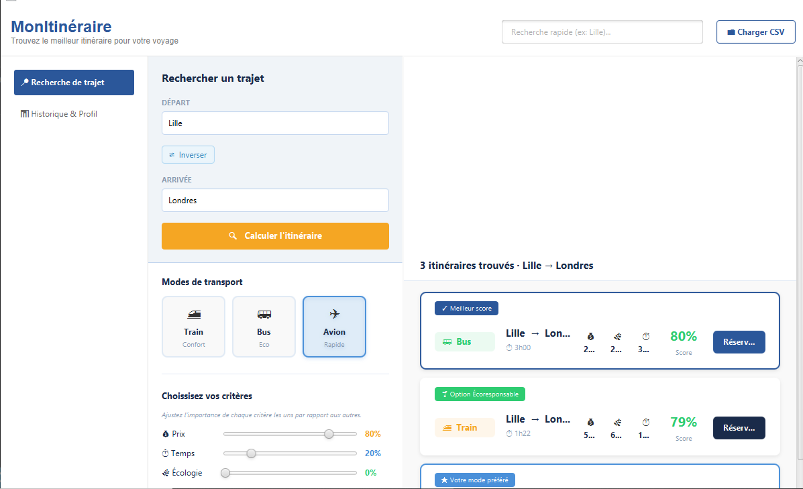

# MonItinéraire - Comparateur de Trajets Écoresponsable (SAE S2.01 / S2.02)

## MonItinéraire - Application JavaFX
---

##  Note importante sur la réalisation du projet

> **Projet réalisé intégralement par Oussama Houaidj.**
> 
>À l’origine, ce projet de SAÉ devait être réalisé en groupe de trois. Faute d’avoir trouvé une troisième personne, nous avons finalement travaillé en binôme. Cependant, mon binôme a pris la décision d’arrêter la formation en cours de route, ce qui m’a conduit à assumer seul l’intégralité de la charge de travail, tant sur les aspects théoriques qu’ergonomiques et techniques.
> 
> J'ai pris la responsabilité de mener à bien toutes les phases du projet :
> * **Design & Maquettage :** Idéation et conception graphique des interfaces sur Figma.
> * **Développement:** Implémentation complète des composants JavaFX .
> * **Documentation & Restitution :** Rédaction des livrables techniques et production de la vidéo de démonstration.

---

## Liens et Ressources du Projet

* **Maquettes Figma :** [Accéder aux maquettes Figma du projet](https://www.figma.com/design/6cC0LLE4pTZWUoGq6vFPej/Paper-Wireframe-Kit--Community-?node-id=7614-648&t=G3VEw4zvb6Kcgrra-0)
* **Vidéo de présentation :** [Visionner la vidéo de démonstration](https://youtu.be/gPHfsMEcm2c?is=oiBMUeJ0xI4VSEFO)

### Aperçu de l'interface 


---

##  Justification des Choix de Conception

L'interface de **MonItinéraire** a été rigoureusement structurée autour des critères ergonomiques fondamentaux:

### 1. Guidage & Visibilité
* **Aide à la saisie :** Une fonctionnalité d'autocomplétion intelligente sur les champs de départ et d'arrivée filtre les villes disponibles dès le deuxième caractère pour guider l'utilisateur et éviter les fautes de frappe.
* **Hiérarchie visuelle :** Les badges de couleur appliqués aux transports permettent une catégorisation instantanée.

### 2. Charge de travail optimisée
* **Réduction de la charge mentale :** L'évaluation multicritère complexe est résumée par un score unique en pourcentage, facilitant une prise de décision immédiate.
* **Lisibilité de l'Historique :** L'onglet *Historique & Profil* utilise des cartes épurées où les couples de villes sont alignés à gauche et les métriques calées à droite, rompant avec la lourdeur visuelle des tableaux de données classique.

### 3. Contrôle explicite de l'utilisateur
* **Maîtrise des critères :** L'utilisateur configure lui-même ses préférences de voyage via les curseurs. L'affichage des détails (panneau expansible) et le déclenchement de la réservation se font uniquement à son initiative.

### 4. Adaptabilité et Flexibilité
* **Traitement des données dynamiques :** L'IHM s'ajuste de façon transparente en fonction des données lues dans le fichier catalogue CSV.
* **Barre de recherche rapide :** Intégration d'un champ de recherche globale en haut de l'application pour filtrer rapidement le contenu.

### 5. Gestion et Prévention des Erreurs
* **Parsing défensif :** Le code nettoie automatiquement les entrées du fichier CSV et intercepte les lignes corrompues pour empêcher tout plantage de l'application.
* **Sécurisation de l'algorithme :** Les curseurs de priorité s'auto-équilibrent mathématiquement en temps réel pour empêcher l'utilisateur de soumettre une pondération globale supérieure à 100 %.

### 6. Homogénéité & Cohérence
* **Uniformité graphique :** Identité visuelle partagée entre les cartes de l'onglet recherche et celles de l'onglet historique
* **Iconographie standardisée :** Utilisation cohérente de pictogrammes universels

### 7. Signifiance des codes (Nudges Écoresponsables)
* **Incitation douce :** Pour répondre au critère d'écoresponsabilité, un badge vert distinctif **" Option Écoresponsable"** est automatiquement greffé sur les trajets en Train. 
* **Équivalence concrète :** Le panneau de détails propose des phrases chocs comparatives (ex: souligner qu'un trajet pollue 12 fois moins qu'un autre) pour donner un sens concret aux valeurs en kilogrammes de CO₂.

### 8. Compatibilité avec la tâche métier
* L'application répond parfaitement au besoin utilisateur : comparer instantanément l'impact financier, temporel et écologique de différents modes de transport pour un même déplacement.

#### Point final

J'aurais aimé pouvoir rajouter certaines fonctionnalités ou orienter davantage l’utilisateur vers des choix écoresponsables. Cependant, étant donné la difficulté de travailler seul sur ce projet, je pense avoir mis en avant l’essentiel de ce qui était demandé.

### Lancer le jar

Pour lancer le fichier **JAR** et accéder à notre application, vous devez vous placer dans le répertoire contenant le fichier JAR, puis exécuter la commande suivante :

```bash
java --module-path votr/chemin/versLaLibrarie --add-modules javafx.controls,javafx.fxml -jar MonItineraire.jar
```

>Nous pensons avoir présenté l’essentiel concernant le travail réalisé. Aucun autre élément significatif n’est à ajouter. Ce document marque donc la fin de notre contribution à cette SAÉ.
*Merci de votre attention à l'égard de notre travail !*